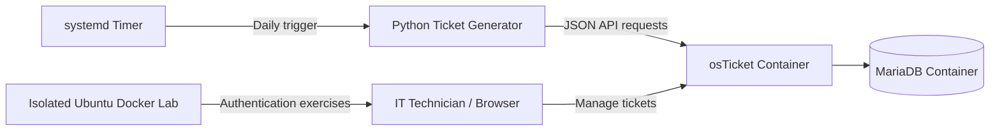

# IT Help Desk & Identity Management Home Lab

**Self-hosted IT support lab | Linux | Docker | Python | IAM | Automation**

I built this home lab to develop practical IT support, Linux administration, identity and access management (IAM), and cybersecurity troubleshooting skills. It combines a working help desk, automated fictional support requests, and isolated hands-on investigations.

> **Lab disclaimer:** This is a personal training environment, not a production company help desk. All employees and incident scenarios are fictional. The account and authentication exercises are performed in isolated lab environments.

## Project Overview

I deployed **osTicket** on an Ubuntu server running CasaOS using Docker Compose, with **MariaDB** in a separate container. I also built a **Python ticket generator** that submits fictional employee support requests to osTicket through its API.

My server uses a **systemd timer** to submit three simulated tickets each day at **9:00 a.m. America/Chicago**. The simulator uses 20 fictional employees and scenarios involving VPN access, DNS, account authentication, software, Linux services, and infrastructure troubleshooting.

### What I Wanted to Practice

- Deploying and maintaining self-hosted IT applications
- Working with Docker containers, Linux commands, and services
- Using APIs and Python to automate repetitive tasks
- Triaging, assigning, investigating, and documenting support tickets
- Understanding password locks, account expiration, and authentication verification
- Recording evidence and distinguishing confirmed findings from assumptions

## Architecture

## Technology Stack

| Technology | Purpose |
|---|---|
| Ubuntu Server | Home lab operating system |
| CasaOS | Home server application management |
| Docker / Docker Compose | Deploying and managing isolated services |
| osTicket | Help desk ticketing and task management |
| MariaDB | Database for osTicket |
| Python 3 | Generating simulated support requests through the osTicket API |
| systemd | Scheduling daily ticket generation |
| Linux CLI / PAM | User-account and authentication troubleshooting |

## Projects and Hands-On Work

### 1. Self-Hosted osTicket Help Desk

- Deployed osTicket and MariaDB as separate Docker services.
- Configured the help desk, API access, and fictional support tickets.
- Created and assigned investigation tasks inside osTicket.
- Used ticket notes to track troubleshooting activities and outstanding work.

**Troubleshooting Highlight — Docker Health Check**

During installation, Apache responded with `HTTP 200 OK`, but Docker reported osTicket as `unhealthy`.

I inspected the container health log and discovered that the default health check attempted to execute `curl`, which was not installed inside the container.

I configured an alternative PHP-based health check through Docker Compose and verified that the container became healthy.

**What I learned:** An unhealthy Docker status does not always mean the underlying application is unavailable. Investigating container logs and health checks is an important part of troubleshooting.

### 2. Automated IT Ticket Generator

I developed a Python-based ticket generator to simulate incoming requests from fictional employees.

**Features:**

- Automatically generates realistic IT support tickets
- Uses fictional employee names and departments
- Connects to osTicket through its ticket-creation API
- Supports multiple incident scenarios and priority levels
- Includes a preview mode before submitting tickets
- Supports automatic daily ticket creation through systemd

The expanded simulator includes 20 fictional employees and scenarios involving networking, VPN connectivity, account access, Linux services, and security incidents.

**Source code:** [Python Ticket Generator](osticket_ticket_generator.py)

> The home lab also runs an expanded v2 simulator. This repository may not yet contain every file used by the live lab; additional sanitized automation files are planned.

### 3. Linux Authentication and IAM Investigation

**Case Study:** [INC-465316 — Linux Password Lock Investigation](INC-465316-Linux-Password-Lock-Investigation.md)

I investigated a simulated Linux account authentication issue using a network-isolated Ubuntu Docker container.

**Investigation activities:**

- Used `getent passwd` to inspect a Linux user account
- Used `passwd -S` to determine password status
- Used `chage -l` to examine account expiration settings
- Investigated the difference between locked passwords and expired accounts
- Restored a deliberately locked password using `passwd -u`
- Verified successful local password authentication using `su`, `whoami`, and `id`

**Key lesson:** A locked password, an expired account, and a lockout caused by repeated failed logins are different conditions.

A password status of `P` does not automatically guarantee successful authentication. A separate authentication test is needed.

**Scope:** The administrative password-lock exercise was completed successfully. The separate simulated suspicious SSH-login investigation remains open and is not presented as resolved by the password exercise.

## Screenshots and Evidence

The [`screenshots/`](screenshots/) folder contains visual evidence of my home lab deployment, ticket management, automation, and authentication troubleshooting.

### osTicket Help Desk Dashboard

### Incident Investigation and Task Management

### Docker Infrastructure

### Python Ticket Automation

### Linux Authentication Verification

### Daily Automation

## Completed Milestones

- [x] Deployed osTicket and MariaDB using Docker Compose
- [x] Diagnosed and resolved a Docker health check failure
- [x] Configured and tested osTicket API ticket creation
- [x] Created a simulated directory of 20 employees
- [x] Successfully generated and submitted fictional IT tickets using Python
- [x] Configured systemd to automate daily ticket generation
- [x] Created and assigned investigation tasks inside osTicket
- [x] Investigated a Linux administrative password lock
- [x] Restored the test account's configured password
- [x] Verified successful local authentication with `su`, `whoami`, and `id`

## Future Projects and Improvements

- [ ] Investigate Linux PAM failed-login behavior and account lockout policies
- [ ] Document additional simulated IT support cases
- [ ] Publish a sanitized Docker Compose example
- [ ] Publish sanitized v2 generator and systemd unit files
- [ ] Expand IAM simulations involving user provisioning and access management
- [ ] Document ticket resolutions with troubleshooting steps and supporting evidence

## Security and Privacy

- All employees, email addresses, and support tickets are fictional.
- No passwords, API keys, database secrets, or session tokens should be included in this repository.
- Authentication experiments are conducted inside isolated Docker environments.
- Simulated investigations are not represented as real corporate security incidents.
- Findings and resolutions are documented with their limitations.

## Learning Goals

My goal is to continue developing practical skills relevant to **IT Support, Identity and Access Management (IAM), Linux administration, and entry-level cybersecurity roles**.

Through this project, I'm focusing on understanding how systems work, identifying problems through technical evidence, automating repetitive processes, and documenting troubleshooting procedures clearly.
