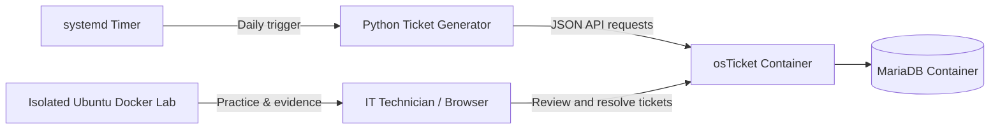

# IT-Helpdesk-Homelab
Hands-on IT support, Linux troubleshooting, IAM, Docker, and osTicket automation projects
IT Help Desk & Identity Management Home Lab
A self-hosted IT support training environment built with Ubuntu Server, CasaOS, Docker Compose, osTicket, MariaDB, Python, and systemd. I use this lab to practice IT ticket triage, Linux administration, authentication troubleshooting, and technical documentation.
> **Portfolio note:** All employees, tickets, and incident scenarios are fictional. Authentication tests are performed in isolated lab environments. This is a personal learning project, not a production company help desk.
Project overview
I deployed osTicket on my Ubuntu home server using Docker Compose with a separate MariaDB container. I then built a Python ticket generator that uses the osTicket API to submit simulated employee support requests. A systemd timer is configured to generate three tickets each day at 9:00 a.m. America/Chicago.
The simulator includes 20 fictional employees from multiple departments and scenarios involving VPN access, account authentication, DNS, Linux infrastructure, software, and other common support issues.
Architecture

Technology stack
Technology	Purpose
Ubuntu Server	Home lab host operating system
CasaOS	Home server app management
Docker / Docker Compose	Isolated services and repeatable deployment
osTicket	Help desk and ticket management
MariaDB	osTicket database
Python 3	Synthetic IT ticket generation through the osTicket API
systemd	Scheduled ticket generation
Linux CLI and PAM	Authentication and user-account troubleshooting
Completed work
[x] Deployed osTicket and MariaDB in Docker containers
[x] Investigated a misleading Docker `unhealthy` status caused by a health check invoking missing `curl`
[x] Configured and tested osTicket API ticket creation
[x] Created a synthetic directory of 20 employees
[x] Successfully submitted test tickets through the Python generator
[x] Configured a systemd timer for daily simulated tickets at 9:00 a.m. Central time
[x] Performed an isolated Linux administrative password-lock and restoration exercise
[x] Verified local password authentication with `su`, `whoami`, and `id`
Case studies
INC-465316 — Linux Password Lock Investigation
Investigated the state of a fictional Linux account in a network-isolated Ubuntu Docker container. Confirmed an administrative password lock using `passwd -S`, checked expiration settings with `chage -l`, reversed the lab-only lock, and verified password authentication as an unprivileged user.
Key learning: A locked password, an expired account, and an automatic failed-login lockout are different conditions. Restoring the password state does not, by itself, prove that login works; authentication needs separate verification.
Read the full incident report
Troubleshooting highlight: Docker health check
During installation, the osTicket web service responded with `HTTP 200`, but Docker showed its container as `unhealthy`. Inspecting the container health log revealed that the image's default check invoked `curl`, which was not installed inside the container. I added an alternative PHP-based health check through Docker Compose.
Lesson: Validate application functionality and investigate the specific health-check command before assuming an application is down.
Planned additions
[ ] Publish a sanitized Docker Compose sample with no credentials or secret keys
[ ] Publish the Python generator and non-sensitive systemd unit files
[ ] Add redacted screenshots of ticket creation and resolution
[ ] Investigate Linux PAM failed-login behavior in a disposable lab
[ ] Document additional simulated support incidents and their verification steps
Security and privacy
No real employee data is used.
No passwords, osTicket API keys, database secrets, or production credentials are stored in this repository.
Network/authentication testing is confined to a lab environment.
The simulated account-restoration exercise is not presented as resolution of the separate suspicious-login scenario.
Learning goals
Develop practical skills relevant to IT Support, Identity and Access Management (IAM), Linux administration, and entry-level cybersecurity roles through repeatable exercises, evidence-based troubleshooting, and clear technical documentation.
